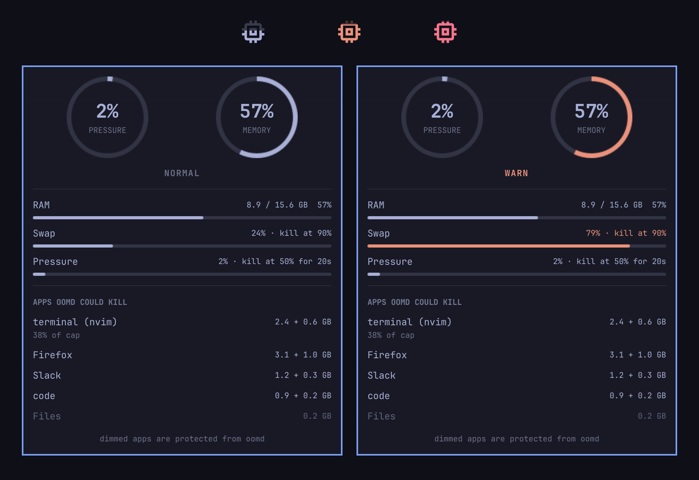

# Memory (oomd) for Omarchy

A fork of [egoist/omarchy-memory-usage](https://github.com/egoist/omarchy-memory-usage), the iStat Menus-style memory widget for the Omarchy bar. Credit for the widget, the rings, the process list and the overall design goes to EGOIST. This fork keeps all of that and makes the widget aware of systemd-oomd, the daemon that kills apps on Omarchy when memory runs short.



The preview image is from the upstream widget.

## What it adds over upstream

- **oomd-aware levels.** The widget judges memory as normal, warn or critical by how close the machine is to an oomd kill, not by RAM used. The bar meter and the pressure ring change color with the level.
- **The binding constraint.** The panel shows which trigger is closest to firing, for example `swap 60% of 90% kill line`, and how long pressure has been held above the limit.
- **Per-app memory by cgroup.** The panel section "Apps (oomd candidates)" lists the units oomd actually kills, with RAM, swap and how full each app's `memory.max` or swap cap is. Apps marked `user.oomd_omit` are dimmed because oomd skips them.
- **Notifications.** Entering warn or critical sends a desktop notification. Critical uses critical urgency and names the largest app oomd could kill.
- **Light polling.** The cgroup scan runs only while the panel is open or the level is warn or worse.
- **Tests.** `tests/run` covers the scripts against fixture trees and the level logic under node.

## Install

From git, once the repository is published somewhere you can clone from:

```sh
omarchy plugin add <git-url> --enable
```

Then place it where you want it, for example right after the agents widget:

```sh
omarchy plugin enable io.github.arnaldo-delisio.memory-oomd --section right --after omarchy.agents
```

From a local checkout, which is how this machine installs it:

```sh
git clone <this checkout> ~/Work/omarchy-memory-oomd
~/Work/omarchy-memory-oomd/scripts/install-local
omarchy plugin enable io.github.arnaldo-delisio.memory-oomd --section right --after omarchy.agents
```

`scripts/install-local` validates the plugin, then copies it without `.git` or `tests` to `~/.config/omarchy/plugins/io.github.arnaldo-delisio.memory-oomd/`. Run it again after any change. The shell reloads plugin files when they change. It uses `rsync` instead of `omarchy plugin add file://...` so the install is a plain copy that you can update in one command.

## Remove

```sh
omarchy plugin disable io.github.arnaldo-delisio.memory-oomd
rm -r ~/.config/omarchy/plugins/io.github.arnaldo-delisio.memory-oomd
```

For a git-installed copy, `omarchy plugin remove io.github.arnaldo-delisio.memory-oomd` does both. If you also run the upstream plugin, the two do not conflict: the ids differ.

## Settings

Set one with `omarchy bar set <id> <key> <value>`, for example:

```sh
omarchy bar set io.github.arnaldo-delisio.memory-oomd notify false
```

| Setting | Default | Meaning |
| --- | --- | --- |
| `width` | 27 | Fixed horizontal widget width. 27 is the standard icon slot. |
| `listMode` | `apps` | Panel list: `apps` (cgroups), `processes` (executables, as upstream) or `both`. |
| `appCount` | 6 | Rows in the apps list (1 to 12). |
| `processCount` | 5 | Rows in the process list (1 to 10). |
| `notify` | `true` | Send a notification when the level enters warn or critical. |
| `notifyCooldownSec` | 300 | Minimum seconds between two notifications of the same level. |
| `swapWarnMargin` | 15 | Warn when swap used is within this many percentage points of the oomd swap limit. |
| `swapCriticalMargin` | 5 | Critical when swap used is within this many points of the swap limit. |
| `pressureWarnPercent` | 50 | Warn when app.slice pressure reaches this percent of the oomd pressure limit. |
| `criticalHoldPercent` | 50 | Critical when pressure has stayed at or above the limit for this percent of the oomd duration. |

## How levels map to oomd

systemd-oomd kills when either of these holds:

1. System swap used is above `SwapUsedLimit` (in `oomd.conf`).
2. The memory pressure of a monitored cgroup, here `app.slice`, is at or above `DefaultMemoryPressureLimit` for `DefaultMemoryPressureDurationSec`. oomd reads PSI **full** `avg10`, which is what the panel's app.slice figure shows.

`scripts/oomd-config` reads the limits the way systemd does: `oomd.conf`, then the `oomd.conf.d` drop-ins from `/etc`, `/run` and `/usr/lib` (an earlier directory shadows a later one by file name, drop-ins apply in name order), plus `ManagedOOMMemoryPressureLimit` drop-ins on `app.slice`. If nothing is configured the widget falls back to swap 90%, pressure 50%, 20 s. Stock systemd uses 90%, 60% and 30 s, and Omarchy sets 50% and 20 s, so the fallback follows Omarchy.

With the limits known, the widget computes:

| Level | When |
| --- | --- |
| warn | swap used >= swap limit - `swapWarnMargin`, or pressure >= pressure limit x `pressureWarnPercent` / 100 |
| critical | swap used >= swap limit - `swapCriticalMargin`, or pressure >= the limit for at least `criticalHoldPercent` of the duration |

With the defaults and Omarchy's limits that is warn at 75% swap or 25% pressure, and critical at 85% swap or 50% pressure held for 10 s. The held-above counter restarts whenever pressure drops under the limit. A level is left only after the value falls a little below where it started (3 points of swap, 20% of the pressure), so the bar does not flicker around a line.

Notifications fire on escalation only. Each level has its own cooldown, so a warn notification does not hold back a later critical one.

## Per-app memory

`scripts/app-memory` reads the cgroup v2 files of the units at depth 1 and 2 under `app.slice`: `memory.current`, `memory.swap.current`, `memory.max`, `memory.high`, `memory.swap.max` and `memory.pressure`. Names come from the unit name with the prefix and suffix removed and `\x2d` unescaped. Terminal scopes are named by what runs inside, for example `terminal (claude)`, preferring claude, codex and nvim over shells. Units that resolve to the same name are summed. Rows are sorted by RAM plus swap, largest first, and the top N are shown. The cap figure is the fullest unit of the app, not a sum.

Use it directly:

```sh
scripts/app-memory --top 10 | jq '.apps[] | {name, ramBytes, swapBytes, capPercent}'
```

## Polling

The bar samples `scripts/memory-stats` every 2 seconds while memory is normal and every 1 second while the panel is open or the level is warn or worse. PSI averages only change about every 2 seconds, so a faster idle poll would only repeat the same numbers. The oomd config is re-read every 5 minutes.

## How the base metrics work

These are unchanged from upstream. Overall usage is `MemTotal - MemAvailable` from `/proc/meminfo`. The composition ring splits physical memory into Applications (anonymous pages plus shared memory), Kernel (the remaining non-cache, non-free memory), Cache (page cache plus reclaimable slab) and Free. The pressure ring still shows PSI `some avg10` of the whole machine, while the level is judged on the `app.slice` figure oomd uses, which the status row shows whenever pressure is the closest trigger. Process totals are RSS grouped by executable name, so shared pages can be counted in more than one row.

## Dependencies and security

The plugin runs unsandboxed with your user permissions, like every Omarchy shell plugin. It does not use `sudo`, install packages, start services or access the network.

It reads `/proc` and `/sys/fs/cgroup`, and uses commands from a standard Omarchy install: Bash, `jq`, `awk`, `ps`, `sort`, `head`, `getconf`, `date` and `notify-send` (libnotify). `getfattr` (package `attr`) is optional: without it the widget cannot tell which apps are protected with `user.oomd_omit` and shows none as protected. `scripts/install-local` also needs `rsync`, and the tests need `node`.

## Tests

```sh
tests/run
```

The shell tests build fixture trees (a fake `/proc`, `/sys/fs/cgroup` and oomd config files) and point the scripts at them with `MEMORY_OOMD_ROOT`, which defaults to `/`. The level logic in `Levels.js` is tested with node. `tests/run` exits non-zero if anything fails.

## License

MIT. Copyright (c) 2026 EGOIST and Arnaldo Delisio, see `LICENSE`.
